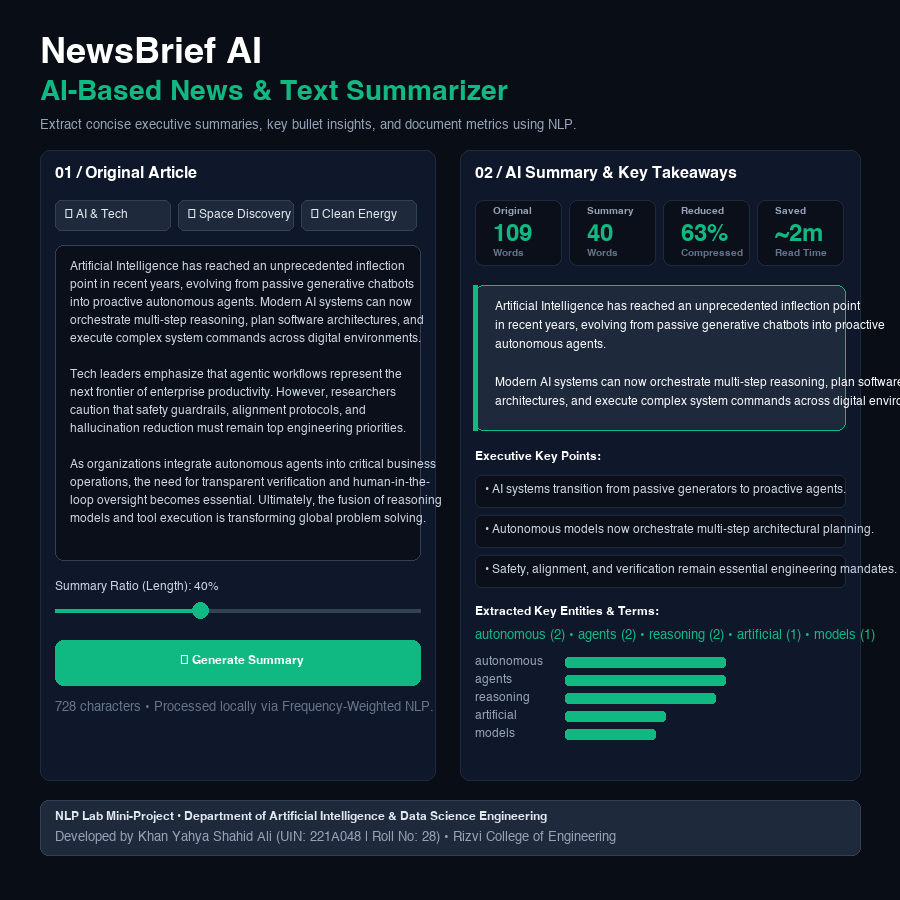

# AI-Based News Summarizer Using Natural Language Processing


> **Mini-Project of Natural Language Processing Lab**  
> Submitted in partial fulfillment of the requirements for the Fourth Year of Bachelor of Engineering in **Artificial Intelligence & Data Science**  
> **Rizvi College of Engineering**, Department of Artificial Intelligence & Data Science  
> **University of Mumbai** (Academic Year 2026–2027)

---

## 👨‍🎓 Project Credits & Academic Details

- **Student Name:** Khan Yahya Shahid Ali
- **Roll No:** 28
- **UIN:** 221A048
- **Department:** Department of Artificial Intelligence & Data Science Engineering
- **Institution:** Rizvi College of Engineering, Bandra (W), Mumbai
- **Affiliation:** University of Mumbai
- **Project Guide:** Prof. Vijay Shankar

---

## 📌 Project Overview

In today's digital information landscape, journalists, researchers, and professionals are flooded with high-volume news articles, research papers, and press releases. **NewsBrief AI** is an interactive, web-based Natural Language Processing application developed in Python with Streamlit to extract high-value executive summaries and bullet insights automatically.

The system utilizes a **Frequency-Weighted Extractive Summarization algorithm** that runs completely locally without requiring paid third-party APIs or heavy external deep learning models.

### Key Capabilities:
1. **Sentence Boundary Disambiguation:** Precision sentence parsing utilizing regex lookbehind assertions.
2. **Normalized Word Frequency Weighting:** Tokenizes, removes stop-words, and calculates normalized salience weights for all vocabulary words.
3. **Sentence Salience Scoring:** Evaluates sentences using length-penalized term weight aggregation to prevent length bias.
4. **Dynamic Compression Control:** Interactive UI slider allowing users to customize summary length from 20% to 80%.
5. **Key Entity & Topic Extraction:** Isolates top topic keywords with occurrence counts.
6. **Dual Presentation Views:** Executive summary paragraph view and bullet-point takeaway list.
7. **Document Metrics:** Computes original word count, summary word count, compression percentage, and reading time saved.
8. **Dual Mode Execution:** Full Streamlit interactive GUI + Standalone headless Terminal CLI demo.

---

## 🏗️ System Architecture & NLP Workflow

```
[ Unstructured News Article Input ]
                 │
                 ▼
[ Sentence Tokenization (Regex Lookbehind) ]
                 │
                 ▼
[ Word Normalization & Stop-word Elimination ]
                 │
                 ▼
[ Term Frequency Matrix: Weight(w) = Freq(w) / MaxFreq ]
                 │
                 ▼
[ Sentence Scoring: Score(S) = Sum(Weight(w)) / sqrt(Length(S)) ]
                 │
                 ▼
[ Top-K Salient Sentence Ranking & Chronological Assembly ]
                 │
                 ▼
[ Interactive Streamlit Dashboard: Paragraph, Bullets, Metrics & Keywords ]
```

---

## 📸 Application Screenshot



---

## 📖 Complete Working & Execution Guide

Follow these steps to run, test, and demonstrate the project on any computer:

### Step 1: Clone the Repository
Open Terminal (macOS/Linux) or Command Prompt (Windows) and clone the repo:
```bash
git clone https://github.com/yxhyxalikhan-dev/ai-news-summarizer-nlp.git
cd ai-news-summarizer-nlp
```

### Step 2: Set Up Virtual Environment (Recommended)
```bash
# Create virtual environment
python3 -m venv venv

# Activate on macOS/Linux:
source venv/bin/activate

# Activate on Windows:
venv\Scripts\activate
```

### Step 3: Install Required Dependencies
Install the required packages using `requirements.txt`:
```bash
pip install -r requirements.txt
```
*Dependencies installed: `streamlit`, `pandas`, `altair`.*

---

### Step 4: Launch the Streamlit Web Application
Run the following command to start the interactive web dashboard:
```bash
streamlit run app.py
```
After executing, Streamlit will display:
```
  You can now view your Streamlit app in your browser.
  Local URL: http://localhost:8501
  Network URL: http://192.168.x.x:8501
```
Your default web browser will automatically open with the **NewsBrief AI** dashboard!

---

### Step 5: How to Use the Web Interface
1. **Entering Text:**
   - Under **`01 / Original Article`**, paste any news story, editorial, or article text.
2. **Using 1-Click Preset News Stories:**
   - Click **`🤖 AI & Tech`** to load an article on autonomous AI agents.
   - Click **`🚀 Space Discovery`** to load a deep-space James Webb telescope discovery.
   - Click **`⚡ Clean Energy`** to load a report on renewable grid storage.
3. **Adjusting Summary Length:**
   - Adjust the **Summary Ratio Slider** (e.g., set to 40% for a concise executive summary).
4. **Generating Summary:**
   - Click the green **`✦ Generate Summary`** button.
5. **Viewing Results:**
   - **Metrics:** Review Original Words, Summary Words, Compression % (e.g., *Reduced by 63%*), and Read Time Saved.
   - **Executive Summary Tab:** Read the distilled paragraph narrative.
   - **Key Point Bullets Tab:** Inspect the key sentence bullet list.
   - **Keywords Tab:** View the top keywords and their frequency bar chart.

---

### Step 6: Headless CLI Mode (Without Browser)
If you need to run the application in a headless environment, automated script, or test terminal without a GUI:
```bash
python3 app.py
```
This triggers the built-in CLI engine and prints structured test results for all sample articles directly in the terminal console.

---

## 📊 Sample Test Results

| Category | Original Words | Summarized Words | Compression Ratio | Key Findings Extracted |
|---|---|---|---|---|
| **AI & Tech** | 109 words | 40 words | **Reduced by 63%** | AI agents shifting from passive chatbots to autonomous planning systems. |
| **Space Science** | 102 words | 41 words | **Reduced by 60%** | James Webb telescope discovers early massive galaxies challenging current cosmology. |
| **Clean Energy** | 101 words | 42 words | **Reduced by 58%** | Renewable investments outpace fossil fuels with battery grid stabilization. |

---

## 📂 Repository Structure

```
ai-news-summarizer-nlp/
├── app.py                                            # Main Streamlit NLP Application & CLI engine
├── requirements.txt                                  # Python dependencies
├── README.md                                         # Complete Working Guide & project documentation
├── .gitignore                                        # Git ignore rules for Python & cache
└── reports/                                          # Academic Lab Project Reports
    ├── Khan_Yahya_Shahid_Ali_News_Summarizer_Report.docx  # Official Word Report
    ├── Khan_Yahya_Shahid_Ali_News_Summarizer_Report.pdf   # Print-Ready PDF
    └── Figure1_News_Summarizer_Dashboard.png              # Application UI Screenshot
```

---

## 🔧 Troubleshooting Guide

- **Issue:** `streamlit: command not found`  
  **Solution:** Ensure you ran `pip install -r requirements.txt`. If still unresolved, run `python3 -m streamlit run app.py`.
- **Issue:** `Port 8501 is already in use`  
  **Solution:** Run on another port using `streamlit run app.py --server.port 8502`.
- **Issue:** Browser does not open automatically  
  **Solution:** Manually open Chrome, Safari, or Edge and navigate to `http://localhost:8501`.

---

## ⚠️ Limitations & Future Scope

- **Extractive vs Abstractive:** Extractive summarization preserves original phrasing; future iterations can integrate lightweight sequence-to-sequence transformers (T5 / BART) for generative paraphrasing.
- **Cross-Lingual Support:** Expanding beyond English to support multilingual Indian languages (Hindi, Marathi, Urdu) via IndicNLP.

---

## 📜 Academic Declaration

This submission represents bonafide academic work developed by **Khan Yahya Shahid Ali (221A048 / Roll No: 28)** for the **Natural Language Processing Lab Mini-Project**, Department of Artificial Intelligence & Data Science Engineering, Rizvi College of Engineering, affiliated with the University of Mumbai.
